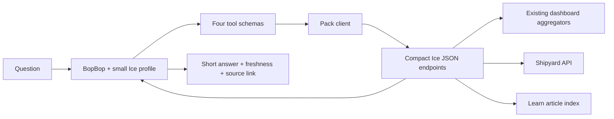

# Ice dashboard context pack: audit and tool plan

Status: proposal, based on the local dashboard source and read-only runtime
checks on 2026-10-07 (America/Chicago). The eye alignment fix is implemented;
the dashboard pack and APIs described here are not implemented yet.

## Recommendation

Build a small dashboard specialist with four native tools, a short context
fragment, and a thin client for compact JSON reports. Keep calculations,
filters, freshness checks, and evidence selection in deterministic code.
Let GPT OSS 20B choose a report and explain the returned facts.



Most questions should need one tool call and one final model reply. Follow-up
questions can request evidence by reference. The first useful slice is
“What needs attention?” and “Explain this dashboard concept.”

## What the audit found

### Useful foundations

The running dashboard is a SvelteKit Node app on port 5175. Its checked-in
service file names another port, and its README still describes a mock-data
wireframe and future FastAPI backend. Use current source and runtime checks
as the implementation references; make the dashboard URL configurable.

| Surface | Current source of meaning | Tool opportunity |
|---|---|---|
| Overview | `dashboard/src/lib/server/aggregate.ts` | Service observations, release results, alerts, activity |
| Operations | `events.ts:loadOpsSnapshot`, `media-vpn.ts:loadMediaVpnStatus` | Timer schedules, runner state, media protection and sample age |
| Incidents | `incidents.ts:buildIncidents` | Incident lifecycle, summary, latest state, bounded evidence |
| Timeline | `events.ts:loadEvents`, `filterEvents` | Filtered observations with stable references |
| Visits | `visits.ts:buildVisitsReport` | Eligible visits, app totals, legacy/canonical coverage |
| Traffic/anomalies | `traffic.ts`, `trusted.ts`, `fail2ban.ts`, anomaly route loader | Assessment reasons, ingestion health, observed ban comparisons |
| Claude usage | `claude.ts:buildClaudeOverview` | Observed tokens and session activity; quota gauge is a heuristic |
| Shipyard | `shipyard.ts:loadShipyardOperator` | Existing versioned operator document with reasons and limitations |
| News | `news.ts`, `news_queue.ts` | Dated briefing and a separate live approval queue |
| Learn | `dashboard/src/content/learn/*.md` | Concept explanations, source pointers, known limitations |

Shipyard already provides loopback JSON at port 8765:

- `/api/operator?window=24h|7d|30d`: structured operator document.
- `/api/summary?window=24h`: counts, services, actionable items, errors.
- `/api/events?window=24h&limit=5`: bounded events.

Its producer has an indexed event reader and a background inspection cache
with a 300-second TTL. Preserve its reported scope, freshness, limitations,
and explicit lineage. Avoid deriving connections from similar titles or
timestamps. The Ice adapter already validates schema-v1 and has a five-second
transport deadline.

### Gaps that matter for this pack

1. **The local harness cannot register pack tools yet.** `pack install`
   copies files and splices prose into `CLAUDE.md`; local `TOOLS` and
   `execute()` currently contain only list/read/write/command operations.
2. **Pack discovery differs by invocation.** The local CLI reads instructions
   from its workspace, which defaults to the invocation directory. The server
   uses `BOPBOP_CONTEXT_DIR`; Claude/Codex terminals also change to that context
   directory. An Ice profile must explicitly resolve its installed pack from
   the context directory while retaining the terminal workspace.
3. **Loading the whole Ice context would be expensive.** Its `CLAUDE.md` alone
   is about 28 KB and contains many unrelated capabilities. Local instruction
   loading currently has no token budget. An Ice profile needs a selected,
   small fragment and required channel rules.
4. **General event reads scan whole daily files synchronously.** `loadEvents`
   parses each file before filtering. The timeline's 200-row limit bounds
   output, not input work. Usage reads the selected window and five hours
   separately. All-history fail2ban reads have a separate incremental cache.
5. **Some meaning is in components.** Operations freshness labels are partly
   calculated in `+page.svelte`. Extract any reused policy into shared server
   helpers so the UI and agent agree.
6. **Missing data can resemble an empty healthy result.** Several loaders
   return `null`, `[]`, or `{}`. Service rows expose only a clock-time label;
   the usage “active session” is inferred from recent records. Add explicit
   availability and full timestamps before presenting these as live facts.
7. **Windowed incident state is incomplete history.** `buildIncidents` joins
   only events inside the requested window. Label that scope; a window with no
   incident events does not establish that there are no open incidents.
8. **Runtime prerequisite:** `/claude/__data.json?hours=24` returned HTTP 500.
   The service journal reports an imported build chunk missing from disk.
   Reconcile the deployed bundle and restart it before treating usage as a
   reliable dashboard capability. This audit did not change that service.

### Measured data and request cost

The archive contained 101 daily event files totaling approximately 1,253 MiB.
The recent two/eight/thirty-one calendar files totaled approximately
34.86/236.23/842.13 MiB. These are the files a 24h/7d/30d read can encounter,
not exact counts of events inside those rolling windows. Learn has 21 articles
totaling approximately 99 KB.

Three sequential loopback GETs per working endpoint, existing running
services, no browser, no concurrent load test:

| Surface tested | Request times (ms) | Median (ms) | Largest response |
|---|---:|---:|---:|
| Operations page data | 112.0 / 4.1 / 3.5 | 4.1 | 26,616 bytes |
| Traffic page data | 30.8 / 8.3 / 4.9 | 8.3 | 97,663 bytes |
| Overview page data, 24h | 224.9 / 179.2 / 168.8 | 179.2 | 5,742 bytes |
| Timeline page data, 24h | 162.2 / 158.3 / 162.2 | 162.2 | 121,769 bytes |
| Shipyard operator, 24h | 259.4 / 27.4 / 63.6 | 63.6 | 37,300 bytes |

These measurements locate current costs; they are not production guarantees.
SvelteKit `__data.json` is an internal page serialization format. Use explicit
JSON endpoints for the pack rather than depending on it or scraping HTML.

## Four tools

| Tool | Inputs | Meaning |
|---|---|---|
| `ice_status` | none | Small health and attention overview with coverage for every included domain |
| `ice_query` | `report`, `window`, optional `project`, `limit` | Measured report: services, incidents, visits, traffic, usage, shipyard, or news |
| `ice_detail` | opaque `ref` returned by a prior result | One item's evidence and explanation, capped in size |
| `ice_explain` | `topic` | Dashboard concepts, collectors, page meanings, and limitations |

Start `ice_query.window` with `24h` and `7d`; default 24h. Add shorter windows
where producers support them later. Traffic reports and dated news editions
have their own source coverage: return the effective window and reject an
unsupported window instead of silently claiming it was applied. Report dates
and live queue state separately. Default to five items, hard maximum twenty.

Use flat schemas and short descriptions. Normalize app names and documented
aliases in code: the probe emitted `Quizly`, which should resolve to the known
`quizly` identifier. Reject unknown projects with a short list of choices.
Expose a report only once its adapter is implemented; registry schemas and
available reports must agree.

Implement `GET /api/bopbop/status`, `/query`, `/detail`, and `/explain` in the
existing Ice server, reusing its aggregators and Shipyard transport. Refactor
functions to accept a shared event snapshot where needed. Keep selected
domains independent so an unavailable usage report cannot block an operations
answer. The pack client uses Python's standard-library HTTP/JSON support.

For Learn, index headings, slugs, aliases, and source references. Return the
best matching sections and their update dates. Ambiguous topics produce
choices; unknown topics produce “not found.” Twenty-one documents are small
enough for a simple lexical index and a curated concept glossary.

## Result contract

Every result should include:

- Schema version, effective scope/window, and source/page links.
- Domain state: `ready`, `empty`, `stale`, `missing`, `invalid`, or
  `unavailable`, with a controlled reason when relevant.
- `generated_at` for the response and `observed_at`/sample age for source
  evidence. Generating a response now does not refresh the observation.
- Named units, scalar totals, a few items, opaque evidence references,
  limitations, and explicit truncation/remaining counts.
- Coverage that identifies queried, unavailable, and unqueried domains.

Target 1–3 KB for a normal report, maximum 8 KB, with bounded strings as well
as bounded row counts. Fetch details separately. Define stable references from
producer IDs or file identity plus byte offset; validate references, including
rotation. An expired reference returns an explicit unavailable result.

Preserve the dashboard's distinctions in code and pack instructions:

- Visits are eligible page loads, not HTTP requests or verified people.
- Proposed bans, observed ban events, and current jail membership differ.
- Zero observations do not verify health or establish an empty global queue.
- Probe/runner timestamps describe observations, not a live connectivity test.
- Usage numbers and quota heuristics must remain separately labeled.
- Legacy event names normalize to current concepts without rewriting history.

## Pack and harness integration

Proposed pack layout:

```text
pack.toml
CLAUDE.fragment.md     # small routing/concept guide
tools.json             # new optional pack extension: schemas + fixed handlers
scripts/ice.py          # same client callable by native and wrapper harnesses
knowledge/             # small glossary/index; full articles stay with Ice
```

Declare `ICE_DASHBOARD_URL` through the existing `required_env` mechanism.
Keep credentials, owner paths, events, and snapshots outside the portable
pack. The pack should install without restarting services or changing the
currently selected server harness.

Add a reusable pack-tool registry to BopBop: load explicitly enabled installed
packs, validate their manifests, dispatch a fixed handler with JSON arguments
on stdin, and receive bounded JSON on stdout. No model-selected executable or
arbitrary URL. Claude/Codex can invoke `scripts/ice.py` as documented by the
fragment; Ollama gets the four native function schemas. All use the same
report contracts.

Proposed invocation: `bopbop local --profile ice`. This new option would load
the selected pack from BopBop's context directory from any current directory.
The Ice specialist profile should expose the four dashboard tools alone.
The current generic command tool grants full user permissions; leaving it
available would make a claim of read-only operation inaccurate.

Start with observation and explanation. The existing news approval endpoint
can send notes, wake sessions, and record decisions; adding that action surface
is a separate capability with its own explicit request/decision handling.

## Speed and model findings

A temporary four-tool schema probe used local `gpt-oss:20b`, temperature zero,
16,384 context tokens, and a 160-output-token cap. It selected the intended
tool for broad attention, Quizly visit counts, and proposed-versus-observed
traffic bans in all three examples. This is a feasibility probe, not a
reliability score.

The current harness sends `think: false`, yet the installed model returned
reasoning text. GPT OSS supports named reasoning levels; use `low` explicitly
and validate against the installed Ollama behavior. See the
[Ollama thinking controls](https://docs.ollama.com/capabilities/thinking) and
[official GPT OSS example](https://github.com/ollama/ollama-python/blob/main/examples/thinking-levels.py).
The installed Ollama version was 0.30.10 and did not return thinking-control
metadata from `/api/show`.

Measured in this small probe:

- Cold first tool selection: 21.82s, including 17.63s model loading.
- With `think: false`, two subsequent selections: 6.98s and 11.42s.
- With `think: low` and stronger coverage instructions, three loaded-model
  selections: 5.30s, 5.16s, 5.46s. Input counts were 456–463 tokens.
- A synthetic partial/stale status followed by a reply took another 5.24s
  in the low-effort probe: roughly 10.5s for that two-model-call interaction.

Prompt wording and cache state differed between the two probes, so the timing
comparison does not isolate reasoning effort. The low setting did shorten the
observed reasoning traces. The first synthetic reply invented “No other
alerts are present.” Stronger coverage fields and instructions improved it to
“No other alerts are confirmed,” which still deserves an explicit unknown
coverage check. Missing and stale cases must pass before rollout.

Practical controls:

1. Keep the selected pack fragment plus tool descriptions under roughly
   1,200 tokens; measure the actual combined prompt on the installed model.
2. Preserve a stable instruction prefix and bounded conversation history.
   Retain recent useful references; avoid replaying old large results forever.
3. Use `think: low` for routine dashboard queries and cap output per call.
   Surface a generation-limit stop explicitly; do not present a truncated
   response as completed.
4. Reuse existing snapshots. Cache compact event-derived reports for about
   15–30 seconds with single-flight refresh. Preserve source freshness and
   invalidate on relevant file/policy changes. File-backed traffic/operations
   reads are already cheap.
5. Start on-demand; add an incremental event index or a small persisted
   summary only if measured 7d/cold requests miss the budget. Reuse Shipyard's
   index for its own events. Avoid a new indexer that duplicates dashboard
   classification logic.
6. Aim for cached report access below 100ms and uncached common 24h reports
   below 500ms. These are targets. Put a bounded overall tool deadline on
   upstream work and return unavailable/partial when it expires. A timeout
   around synchronous parsing cannot cancel CPU work; worker isolation or
   indexing is required if that becomes a problem.
7. Expect ordinary model-mediated answers in seconds: an initial warm target
   is around 6–12s, to validate on real reports. Prewarm only the selected
   model if cold startup is unacceptable. A later `/ice status` command could
   render a deterministic summary directly for immediate access.

## Telemetry and rollout

Keep current call/token/turn counters and add report domain, requested and
effective window, source age, cache hit/age, response bytes, truncation, and
coverage. Separate first stream activity from first answer text; a thinking
chunk is not an answer. Record enough locally to explain latency without
persisting raw private event payloads.

### Phase 1: one complete useful slice

- Reconcile the deployed dashboard bundle and misleading setup docs.
- Add the reusable optional pack-tool registry and explicit profile loading.
- Implement compact `ice_status` and `ice_explain`, with only their schemas
  exposed initially. Document freshness, roles, pages, and key caveats.
- Package and exercise it from a directory unrelated to either repository.
- Show broad health and explanation demos in both local and wrapper harnesses.

### Phase 2: measured reports and evidence

- Add `ice_query` and `ice_detail`; start with services, visits, and Shipyard.
- Add incidents, traffic, usage, and news adapters as their contracts pass.
- Compare report totals and population rules to the dashboard's own helpers.
- Return real source links, stable references, and explicit history limits.

### Phase 3: speed and comprehension gate

Use a small fixed question set covering normal health, per-app visits,
proposed bans, usage heuristics, ambiguous names, stale/missing sources,
malformed records, partial incident history, expired references, and event
text that resembles instructions. Check exact numbers against fixtures,
appropriate tool/arguments, supported claims, and useful concise replies.

Measure cold/warm model latency, first answer, end-to-end turn time, tool
latency, token counts, output size, and 24h/7d behavior. Set acceptance targets
from those measurements; do not extrapolate the three-question probe into a
reliability guarantee. Optimize the measured bottleneck and then enable the
pack for everyday use.

## Audit artifacts

Temporary raw measurements and schema probes live in
`/tmp/bopbop-ice-audit/`: `benchmarks.json`, `tool-probe.json`, and
`tool-probe-low.json`. Synthetic test health is deliberately separate from
real dashboard observations. No Ice source, live harness selection, approval
queue, or service configuration was changed during the audit.
